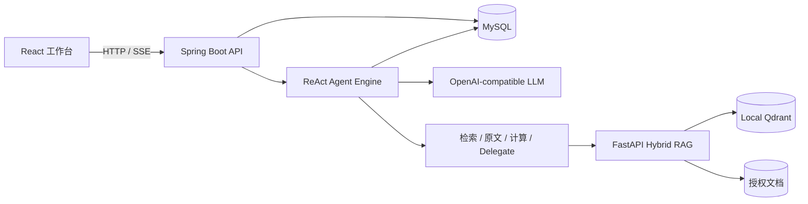

# FinTrace

面向金融长文档核查的可追溯 Agent 平台：把 PDF、HTML、TXT 或文档截图转化为可检索资料，使用 ReAct / Tool Calling 完成跨文档取证、精确计算与多 Agent 并行核查，并将答案关联到可定位的原文证据和人工审阅记录。

[](https://github.com/dxin66/fintrace-agent/actions/workflows/checks.yml)
[](LICENSE)

> FinTrace 是工程与评测项目，不提供投资、法律或合规意见。模型结论必须由专业人员复核。

## 为什么做这个项目

金融分析师面对年报、监管文件和处罚决定书时，真正困难的不是生成一段摘要，而是同时解决四件事：从长文档中找准事实、核对统计口径、完成可复算的数值推导，以及让审阅者快速回到原文。FinTrace 将开放式分析交给 Agent，将权限、事务、引用校验和审阅状态交给确定性后端，避免让模型决定系统边界。

## 核心能力

- **证据驱动的 ReAct Agent**：主 Agent 自主选择混合检索、原文读取、`BigDecimal` 计算和子任务委派；跨年度、跨文档问题可启动最多两个独立上下文子 Agent。
- **Hybrid RAG**：BM25 与稠密向量各自召回后使用 RRF 融合；检索范围先按用户和任务授权文档裁剪，任一分支失败都会显式报错。
- **Claim–Evidence 约束**：最终答案中的引用必须来自当前任务已检索且有权限的证据；失败的计算必须重新成功后才能完成。引用可跳转到 PDF 页码或文本段落。
- **可审阅、可追溯**：Agent 运行、工具调用、证据、SSE 事件与人工确认/修正均持久化；客户端可用 `Last-Event-ID` 恢复事件流，而不会重新执行模型任务。
- **后端一致性**：MySQL 唯一约束实现幂等提交，短事务认领任务附件，乐观锁阻止过期审阅覆盖；有界线程池、超时和取消信号控制资源。
- **文件处理**：支持文字层 PDF、UTF-8 HTML/TXT 与 PNG/JPG。图片 OCR 使用 macOS Vision；复杂表格、图表语义和扫描版 PDF 仍需人工处理。

## 系统结构



一次任务的边界与状态流详见 [docs/architecture.md](docs/architecture.md)。

## 技术栈

| 层次 | 实现 |
| --- | --- |
| Web | React 19、TypeScript 5.9、Ant Design、Vite、Vitest |
| API 与 Agent | Java 21、Spring Boot 3.5、Spring Security、MyBatis、ReAct / Tool Calling |
| 检索 | Python 3.12、FastAPI、PyMuPDF、jieba、BM25、Dense Retrieval、RRF、Qdrant |
| 数据与事件 | MySQL 8.4、Flyway、持久化 SSE、幂等键、乐观锁 |
| 评测 | FinQA、Recall@K、MRR、Execution Accuracy、Program Accuracy、Citation F1 |

## 已记录的评测结果

评测使用 FinQA 官方仓库固定提交的数据，开发集 883 题用于迭代，配置冻结后在公开测试集 1,147 题上运行一次。数字来自本项目现有评测记录，不是金融业务正确率。

| 公开测试集 / 冻结配置 | 结果 |
| --- | ---: |
| RRF Recall@5 | **85.15%** |
| RRF MRR | **81.23%** |
| 全部证据命中率@5 | **74.72%** |
| Execution Accuracy | **50.22%** |
| Program Accuracy | **41.50%** |
| Citation F1 | **83.84%** |

冻结配置为 `BM25 + Dense / RRF Top-10 + qwen-plus-latest + v3 结构化程序协议 + 1 次执行校验`。受控 Dev 对比中，执行校验使 Execution Accuracy 提升 1.92 个百分点、Program Accuracy 提升 1.13 个百分点。项目另有 95 项自动化测试；完整口径、边界和真实流程验收见 [docs/verification.md](docs/verification.md) 与 [evaluation/README.md](evaluation/README.md)。

## 本地运行

完整功能目前以 macOS 为目标平台，因为图片 OCR 依赖 Apple Vision。PDF、HTML、TXT 的核心链路及 Java/Web/Python 测试可在其他平台单独运行。

### 1. 环境要求

- JDK 21
- Maven 3.9+
- Python 3.12
- Node.js 22 与 npm
- MySQL 8.4 客户端和服务端程序
- macOS Command Line Tools（提供 `swiftc`，用于图片 OCR）

脚本不包含本机绝对路径。它们优先从 `PATH` 查找依赖；如依赖未加入 `PATH`，可设置 `JAVA_HOME`、`MAVEN_HOME` 或 `MYSQL_HOME`。Maven 本地仓库需要自定义时设置 `MAVEN_REPO_LOCAL`。

macOS 使用 Homebrew 的安装示例：

```sh
brew install openjdk@21 maven python@3.12 node@22 mysql@8.4
export JAVA_HOME="$(/usr/libexec/java_home -v 21)"
export PATH="$(brew --prefix mysql@8.4)/bin:$(brew --prefix node@22)/bin:$PATH"
```

### 2. 安装依赖

```sh
python3.12 -m venv .venv
.venv/bin/pip install -r rag/requirements.lock
npm --prefix web ci
```

### 3. 创建本地配置

```sh
mkdir -p .runtime
cp config.example.json .runtime/config.json
chmod 600 .runtime/config.json
```

编辑 `.runtime/config.json`，填入数据库密码、登录密码、内部令牌和 OpenAI-compatible 模型服务密钥。该文件、运行日志、数据库、索引和上传文件均位于 `.runtime/`，不会提交到 Git。

### 4. 构建并启动

```sh
./scripts/build.sh
.venv/bin/python scripts/runtime.py start
```

打开 <http://localhost:8080>，使用账号 `demo` 和 `DEMO_PASSWORD` 配置的密码登录。启动器会在项目的 `.runtime/` 中初始化独立 MySQL 数据目录，并仅监听 `127.0.0.1:3307`；不会操作系统默认数据库实例。

```sh
.venv/bin/python scripts/runtime.py status
.venv/bin/python scripts/runtime.py stop
```

可以上传自己的授权材料，也可用 [samples/synthetic_financial_report.txt](samples/synthetic_financial_report.txt) 验证上传、检索、计算和引用链路。真实年报与监管文件不随仓库分发。

## 测试

```sh
npm --prefix web run type-check
npm --prefix web run lint
npm --prefix web run format
npm --prefix web test
npm --prefix web run test:coverage

.venv/bin/python -m pytest rag/tests -q
PYTHONPATH=evaluation .venv/bin/python -m pytest evaluation/tests -q
.venv/bin/python scripts/check-image-ocr.py

.venv/bin/python scripts/runtime.py start-core
.venv/bin/python scripts/java-tests.py
```

Java 集成测试使用独立数据库 `financial_workflow_test`，模型调用由测试替身代替。真实模型预检和业务验收会产生 API 用量，需显式运行 `scripts/preflight.py` 与 `scripts/acceptance.py`。

## 目录

```text
backend/     Spring Boot API、Agent Runtime、工具、持久化与测试
rag/         文档解析、OCR、混合检索服务与测试
web/         React 工作台、SSE、引用与人工审阅界面
evaluation/  FinQA 数据固定、检索/程序/引用评测与逐题报告生成器
docs/        架构边界与可复核的本地验收记录
scripts/     构建、启动、测试和真实流程验收入口
samples/     可公开分发的合成测试文档
```

## 安全与限制

- 文档和工具输出按不可信输入处理；上传 HTML 不执行脚本。
- 资源访问按用户和任务授权范围过滤，内部检索接口需要独立令牌。
- 引用校验能证明引用存在、权限合法且计算工具成功，但不能自动证明自然语言论断与证据完全一致，人工审阅仍是必要环节。
- Qdrant 使用本地持久化模式；当前实现不是高可用集群，也不包含自动交易或生产级合规承诺。
- 模型与向量生成调用云端 API。只处理已获授权上传到所配置服务的材料。

## License

[MIT](LICENSE)
